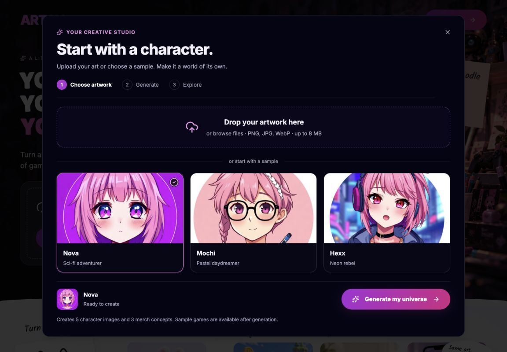

# Focused creator journey

The studio now focuses on the task the visitor has already chosen, instead of repeating the homepage pitch in a right-hand column.

1. **Choose artwork.** Upload or drag an image, or select any sample. A visible selection and one Generate action replace auto-starting each sample click. The homepage's Create action with uploaded artwork goes directly to generation without repeating confirmation.
2. **Generate.** Show the original character, one loading message, neutral placeholders and a stop action. Do not show unrelated artwork as if it were the user's results. No invented percentage or completion time is displayed.
3. **Explore.** Use Creations, Merch and Play tabs. Images have download controls. Merch is explicitly labeled as concepts, without mock prices. Game-stage progression applies inside Play, not to selecting art samples.

Generation, source artwork and results survive closing/reopening the studio for the lifetime of the page. Reloading or leaving the page clears this in-memory session. Regeneration retains previous successful results if the new attempt fails. Stopping aborts the browser request; it does not guarantee cancellation of provider-side work already started.

The optional early-access form is collapsed below the results. Its copy accurately describes waitlist registration and does not claim to save generated images or guarantee an unsupported training/privacy policy.

## Screenshots

[Mobile selection](previews/studio-mobile.jpg)

## Checks

- TypeScript, ESLint on changed TypeScript files, production build and whitespace checks pass.
- Browser checks: Generate disabled without artwork; sample selection; loading view; partial results; tab navigation; retained game locks; failed first attempt with retry; failed regeneration retaining existing downloads; close/reopen during generation and after results; cancellation returning to artwork; homepage upload going directly to generation.
- Mobile document and dialog have no horizontal overflow at a measured 312 CSS-pixel viewport.
- Generation success, partial success, delayed completion and error responses were tested through a temporary local proxy. No live AI generation or waitlist writes were used for this verification. The proxy is not part of the app.
