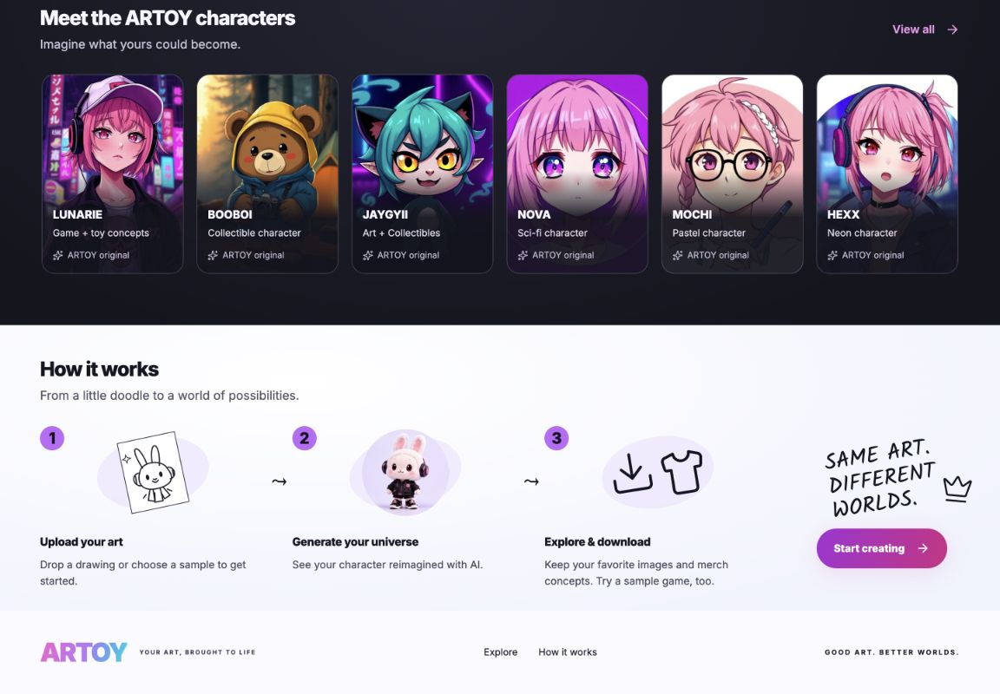

# Customer journey audit — 11 October 2026

This follow-up removes friction and repeated sales language while preserving the playful visual direction and working creator features. It builds on the focused studio redesign in PR #2.

## Changes

- Removed the closing corporate manifesto, repeated value statements, redundant gallery caption and search-shaped link that only jumped to the gallery.
- Replaced “Playable IP” with plain language. Hero, showcase, transformation captions and metadata distinguish AI image concepts from playable demos and physical products.
- Reduced How it works to three steps: upload, generate, explore/download. Waitlist registration is optional rather than a required fourth step.
- Added a sample-game entry before generation. Both entry and results offer stage switching, so a locked Mochi/Hexx stage has a direct route back to Nova and uploaded artwork no longer leads to an empty game tab.
- Kept game locks separate from art selection. All three art samples remain available.
- Added an explicit keep/download reminder before starting a new character, with an option to keep exploring. Successful results remain available if regeneration fails.
- The homepage clears a submitted file selection and shows Return to my studio for an existing session; reopening does not restart the uploaded file.
- Wrapped mobile game controls, enlarged touch targets and gave the tutorial its own readable minimum height without forcing horizontal overflow.
- Separated the game gate from its playable state, so resetting unlocked progress unmounts the game safely instead of changing the number of React hooks. The existing game file was formatted as part of this fix.

## Verification

- TypeScript, production build, changed-file ESLint and whitespace checks completed. ESLint has no errors; the game loop retains its existing `finishRound` dependency warning. Production tooling retains existing dependency/chunk warnings.
- Browser walkthrough at measured 1152px desktop and 312px mobile CSS widths: navigation, gallery expansion, gallery-to-studio entry, selected artwork, disabled Generate without a source, uploaded artwork entering generation, delayed generation, cancel, partial results, failed regeneration preserving earlier results, new-character prompt/cancel, and closing/reopening the studio.
- Game entry is available without generation. Switching to locked Mochi and back to Nova works; tutorial and pause work with no browser errors after the state refactor.
- Mobile document and creator dialog widths match their scroll widths, including the expanded tutorial. Controls and tutorial text no longer clip sideways.
- Waitlist disclosure, explanatory copy and invalid-email form validation inspected. No real signup was submitted.
- Generation responses were local fixtures (partial success, delay and failure), not paid AI calls. Download links contain the generated image and download filename; the in-app browser did not emit a download completion event, so an actual saved download remains unverified here.

## Limits

Live AI output quality and delivery of waitlist emails were not tested. Results persist only within this page session. Stopping generation aborts the browser request but does not guarantee cancellation of work already started by the provider. The game remains a prebuilt sample, and merch remains conceptual.

[Mobile studio](previews/journey-audit-mobile.png)
