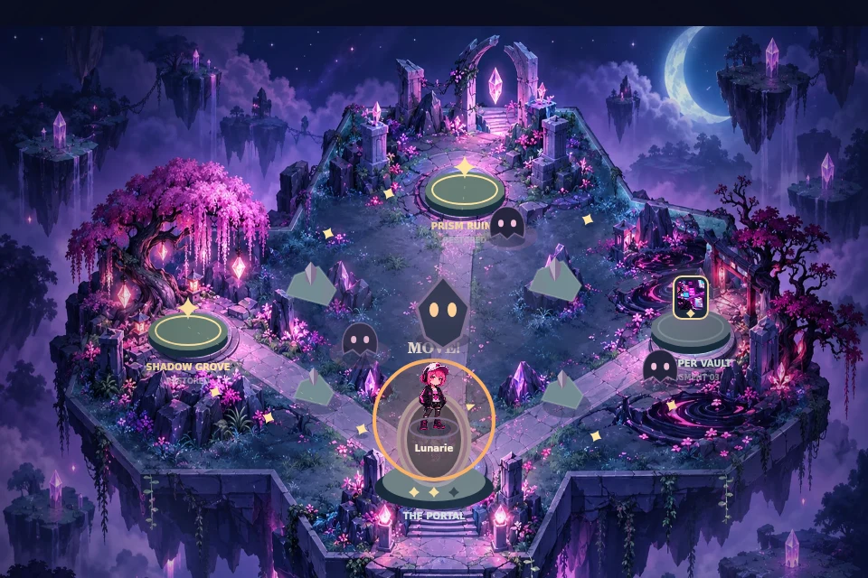
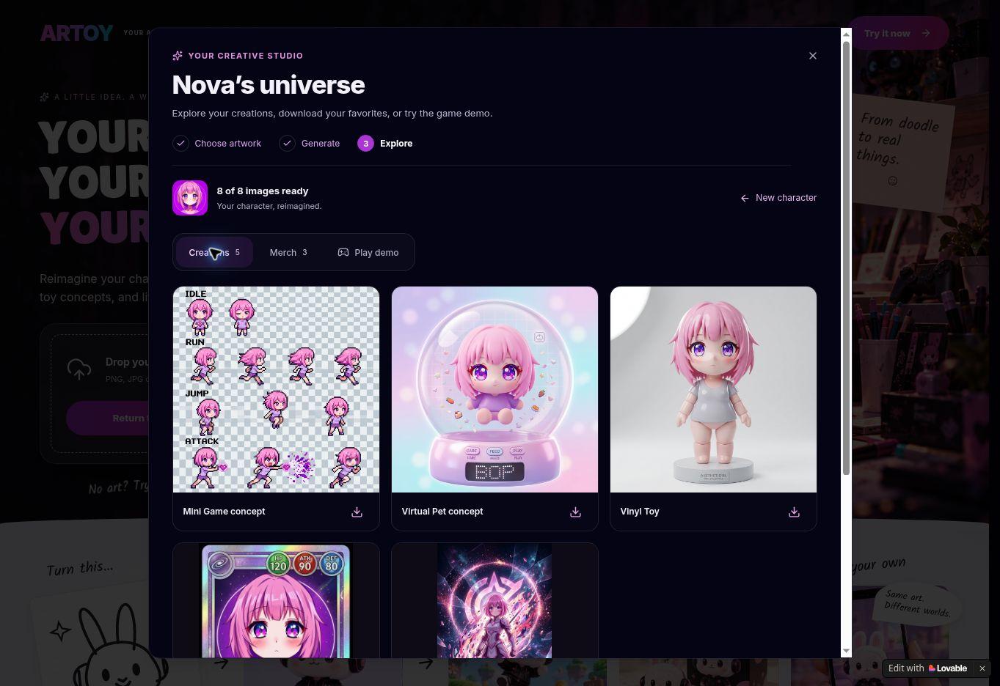
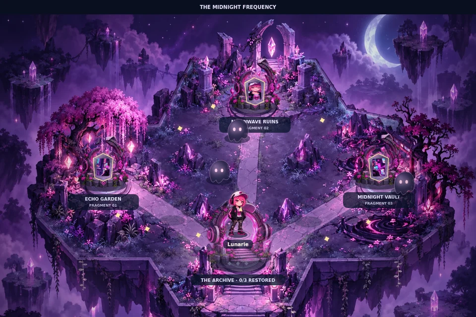
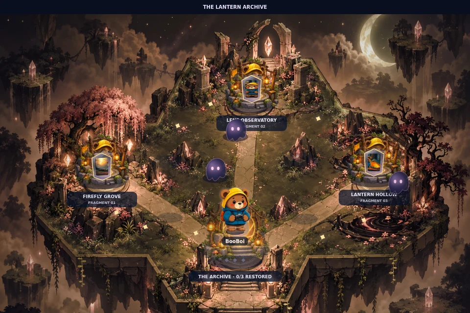
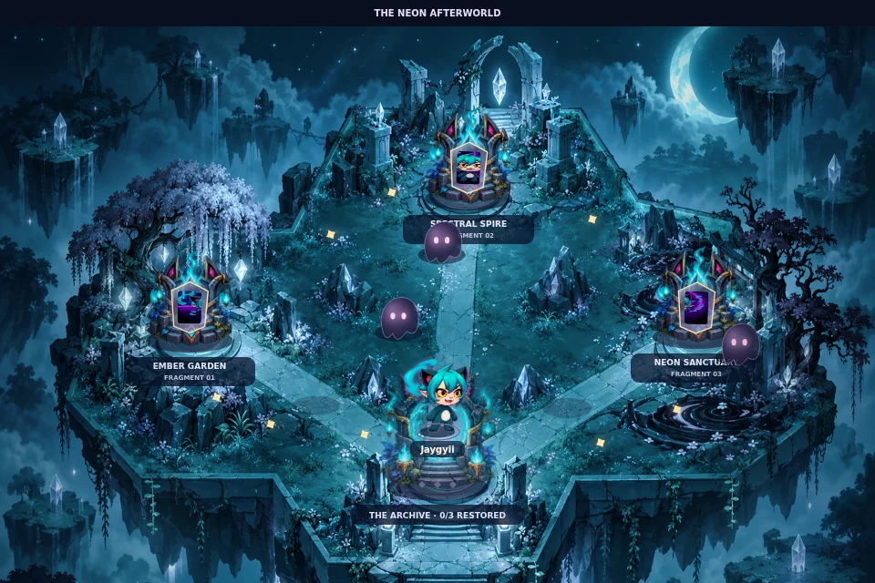

# Game module audit and overhaul — 13 October 2026

This is a chronological implementation log. The latest world, motion, browser-validation and release notes are in the final section below; earlier access restrictions describe earlier sessions.

The previous Play tab ran a disconnected sample game. This change replaces it with **The Lost Fragments**, one authored adventure personalized by the selected artwork.

## Findings

Audit baseline: commit `3f1f7de`, plus a walkthrough of the live studio at `https://artoy.bryanlauwk.fun/`.

| Finding                                   | Evidence in the baseline                                                                                                    | Effect                                                                  |
| ----------------------------------------- | --------------------------------------------------------------------------------------------------------------------------- | ----------------------------------------------------------------------- |
| Artwork and gameplay were disconnected    | `TryItNow.tsx` always rendered `SampleGame`, which supplied a sample avatar. `PixelSocialSim` rejected a missing sample ID. | Uploaded characters could not inhabit their own universe.               |
| Generation had no playable asset contract | The API's “Mini Game” request produced a four-pose concept sprite sheet, which Play never consumed.                         | Generated game art was an image download, not a playable character.     |
| Character identity was replaced           | The renderer drew a chameleon body with a small circular face crop.                                                         | Every input became the same mascot instead of retaining its silhouette. |
| Waiting counted as winning                | `timeLeft <= 0` called `finishRound(true)`.                                                                                 | Players could finish without recovering the gems.                       |
| Timing depended on frame rate             | Movement, stamina, patrols and the clock advanced once per animation frame.                                                 | Different displays and slow devices changed game speed.                 |
| Entry demanded too much learning          | Color thresholds, paint stamina and stealth required a multi-step tutorial; other character stages were locked.             | The demo delayed the first meaningful interaction.                      |

The supplied visual references established the intended relationship: an identifiable character inhabits a coherent world and becomes a playable experience alongside collectible concepts. They were used as product references, rather than as a claim that their illustrated game scenes already existed in the app.

## Curated template

**Premise:** the character's portal has lost its light. Recover three pieces of its artwork to restore the universe, then bring the hero home.

- **One map, one rule set:** a moonlit floating island with Shadow Grove, Prism Ruins and Whisper Vault. Terrain geometry and the four solid rocks match the collision model. Decorative scenery is not additional collision geometry.
- **One main action:** move and dash. Dash protects the hero and stuns roaming inklings for 2.5 seconds, followed by a 1.25-second recharge. Patrol routes remain visible, and an objective compass points to the nearest uncollected fragment or the opened portal.
- **Clear stakes:** three hearts and 90 seconds. Completion requires all fragments plus entering the portal. Timeout and losing every heart are losses.
- **Replay and reveal:** optional sparks, remaining time and surviving hearts improve the score. Completing the chapter unveils the generated figurine concept from the same source artwork, with a route to the Merch tab. Without a successful concept image, the archive reveals a digital character card using the original art. Failed concept images fall back to that card; losing and restarting do not retain the reveal. Personal bests are local to each original artwork; they confer no physical merchandise reward or purchase entitlement.
- **Artwork integration:** original art is immediately playable as a framed floating token. Its palette themes the environment, three actual image slices become the fragments, and the whole artwork appears inside the portal. The neutral signature palette is clearly labeled when usable colors cannot be extracted.
- **Generated hero:** the API now creates one isolated full-body **Game Character**. It preserves the identity reference and requests a plain white background, minimal margins and no extra poses. Edge-connected near-white pixels are removed locally and transparent margins are trimmed. The full generated image is used as the playable hero, without adding a generic body. Missing or failed hero assets retain the original-art token.
- **Desktop and touch:** scoped keyboard controls, tap/drag destinations, held touch directions, dash, pause, restart, optional sound and optional fullscreen. Narrow canvases use a 640px camera view that follows the hero; the world remains 960×640. Inactive windows and hidden tabs pause the run. Reduced-motion preferences disable cosmetic animation.

The game engine is deterministic and independent of AI output. This provides a tested baseline for every input; generation changes the character asset, not the level rules. The original-art token is an intentional fallback, not automatic rigging or a guarantee that arbitrary artwork can become an animated character. The generated hero uses a single composited pose with subtle motion; it is not a skeletal animation system.

## Source organization

- `FragmentQuest.tsx`: controls, lifecycle, camera, audio, HUD and score persistence.
- `quest/engine.ts`: authored geometry, movement, dash, patrols, objective state and scoring.
- `quest/artwork.ts`: palette extraction and generated-image compositing.
- `quest/render.ts`: world art, character rendering and gameplay feedback.
- `TryItNow.tsx`: selected source and generated hero wiring, plus a sample entry before generation.
- `api/generate-universe.ts`: the single-hero prompt and per-asset error isolation, preserving other successful creations if one provider request fails.

Removed the old chameleon module, sample lock/progression helpers, unused game showcase, legacy art assets and obsolete audit script.

## Verification

- Nine persistent engine regression tests pass: completion conditions; timeout at 30/60/120 fps; phase/timer freezing; normalized frame-independent movement; dash and cooldown; damage grace period; rock/boundary collisions; map reachability; restart and scoring. Run `npm run test:game`.
- DOM integration checks used React StrictMode, a Happy DOM fixture and a native canvas adapter: start/pause/resume; scoped keyboard dash; window-blur pause; restart; artwork and palette reset; generated-hero success and failed-image fallback; white-edge removal and transparent trimming while preserving an enclosed white detail; timeout result; real `TryItNow` and `useCreatorSession` wiring for an uploaded source and a partial generated result; animation-frame cleanup on unmount.
- The world renderer was stubbed in the DOM lifecycle checks; the actual renderer was checked separately through the code render. The DOM fixture does not measure CSS layout or mobile overflow.
- An API-handler fixture simulating a failed Game Character provider request preserved the other seven successful assets and returned the partial results successfully.
- Generation responses and the full-body hero in those checks were local fixtures. Waitlist writes were disabled. No paid image generation was performed.
- Rendered and visually inspected the actual world renderer using the repository artwork. The image below is a code render, not a browser screenshot.
- TypeScript, changed-file ESLint, production build and whitespace checks pass. Production tooling still reports existing large-bundle and upstream dependency/deprecation warnings.

Full browser interaction and responsive layout verification were blocked by local-preview restrictions in this environment. Real phone testing, fullscreen/audio behavior on specific browsers and live AI asset quality remain to be verified before release. The DOM check is not a replacement for those checks.

## Next quality gate

Bryan selected a mysterious signature world and a collectible reveal on completion. **Lunarie** (`src/assets/artoy/lunarie.png`) is the chosen benchmark and default sample adventure. Her pink hair, cap, headphones, dark jacket and distinctive skull graphic provide concrete visible identity details to preserve across the source, game hero and figurine concept. Other samples remain freely selectable.

The current implementation is a functional foundation rather than the final owner-facing “wow” standard. That standard requires immediate recognition of the IP in motion, readable idle/run/dash animation, environmental details that meaningfully reflect the character, and a collectible reveal that carries the same identity. A single composited hero pose and palette changes alone do not satisfy it. The benchmark should be used to assess those improvements without changing the curated gameplay rules.

The follow-up DOM fixture verified that only a win reveals the concept, its image comes from the provided figurine asset, the concept action invokes navigation, image failure restores the source-art card, and restarting hides the reveal. The updated Lunarie world was rendered and visually inspected separately. TypeScript, changed-file ESLint, the nine engine tests and the production build pass. Browser/device and live-generation checks remain outstanding.

Play the chapter on a real phone and desktop, then test live generation with a doodle, an illustrated mascot, a dark/white-heavy character and multi-subject artwork. Check that the single hero stays recognizable and that edge cleanup does not erase white details connected to the outside. If live generation fails that visual contract, improve asset preparation while keeping the curated gameplay unchanged. Merch continues to be concept previews.

## Motion, guardian and archive follow-up (13 October 2026)

The single curated adventure now has an escalating arc: the first fragment awakens the ruins; the second wakes the Archive Warden; the third starts a 20-second escape, capped by the original 90-second deadline. The Warden locks its target and warns for 0.9 seconds before striking. Dashes protect the hero and can stun the stalking Warden. Pausing freezes its attack clock.

Lunarie is the animation benchmark, with eight poses for idle/blink, alternating run strides, dash and hit/recovery. Uploaded artwork uses optional generated motion sheets conditioned on both the original art and the generated full-body hero. Sheets must satisfy a 4-by-2 contract and client-side isolation/coverage checks; failed sheets fall back to the full-body hero, then original artwork. These geometric checks do not prove semantic identity fidelity; generated sheets still need visual review. The painted mysterious island is a shared template; source artwork and its palette appear in monuments, the hero and world accents.

The collectible remains win-only. The archive opens over 1.8 seconds, supports skipping and reduced motion, then offers saving the preview and exploring existing merch concepts. Missing figurines reveal the original character card instead. This is a concept reveal, not an order or a claim of manufacturing readiness.

### Generation contract update

Reference-image requests now use multipart `/v1/images/edits`, rather than the unconventional chat-message payload sent to `/images/generations` (which the older public deployment currently accepts). The current model ID and request contract were checked against the published `@tanstack/ai-lovable` 0.5.4 adapter source and https://tanstack.com/ai/latest/docs/adapters/lovable. Motion is an optional ninth output after a successful Game Character result. Base images remain available if motion generation fails. Provider errors are returned without copying provider response bodies into the public UI.

### Validation and remaining limits

- 15 automated gameplay and generation-contract tests pass, covering guardian warnings, locked targeting, dash protection, final escape, timing/pause, win/loss conditions and reference uploads.
- TypeScript and production build pass. Changed TypeScript files pass ESLint. Repository-wide ESLint still fails on existing unrelated files.
- DOM interaction checks pass for start/pause/resume, keyboard dash, blur pause, restart, artwork/theme replacement, partial generation results, hero fallback, win-only collectible, navigation and cleanup. These checks use a DOM fixture and a separate native-canvas render; they do not constitute real-device testing.
- The real eight-pose benchmark passes the motion parser. The preview image is rendered by the actual game renderer, with a fixture Warden warning state.
- A direct public-art request returned non-JSON HTTP 403, but a subsequent public-site UI test successfully generated all eight Nova outputs. The published site still runs the older Mini Game concept and disconnected chameleon Play demo; it does not include the previously merged Lost Fragments changes. The connected development preview requires Lovable sign-in. Successful live generation on the revised endpoint and actual iOS/Android/desktop browser playthroughs remain pending; do not report priority 5 as fully complete.
- The painted art retains decorative stone props in addition to the visibly drawn collider rocks. Map/art alignment and touch navigation need a real playtest before calling this a release-quality game. The guardian is original shared-world art rather than a generated antagonist specific to each IP.

### Asset direction

Motion prompt: preserve Lunarie's pink bob, cap, headphones, face and skull jacket; create eight isolated full-body poses in a regular 4-by-2 sheet with clear opposite run strides and transparent background. The lower body is a curated interpretation of the portrait reference. World prompt: transform the authored island layout into a richly painted mysterious moonlit archive with violet crystals, ruined shrines, shadow grove, open traversable paths and no characters or UI. Both assets were generated from existing project references, inspected and optimized for the repository.

## World and collectible follow-up (13 October 2026)

The shared moonlit island now picks up a soft color bloom at each landmark from the selected artwork palette. Restored fragments brighten their shrine and add a visible resonance ring, so the world changes as the player's universe is repaired while keeping the same map and rules for every character.

The win overlay now has an **Open character archive** action. It reveals the reward immediately and moves focus to the collectible card, where the player can save the concept preview or continue to the existing collectible concepts. The reduced-motion preference uses an instant scroll. The archive remains win-only; when the figurine asset is missing or fails to load, the original art card remains the fallback.

### Verification and limits

- Gameplay and generation contract tests pass; TypeScript, changed-file ESLint and the production build pass.
- The supplied reference images and the repository's Lunarie, BooBoi and Jaygyii art were reviewed as visual references. The three project examples span anime, cozy mascot and fantasy-creature styles.
- The saved DOM interaction harness could not run because its `@napi-rs/canvas` dependency is absent from this checkout. A local production preview also could not bind a port (`EPERM`). No live AI generation or real phone/desktop browser playthrough was available, so the reveal navigation, canvas rendering across inputs and responsive behavior still need hands-on confirmation.

## Character worlds and in-arena finale — current follow-up

The curated map and deterministic rules remain shared. Each benchmark now has a clearly recognizable identity throughout its architecture and effects:

| Character | Chapter | World motifs |
| --- | --- | --- |
| Lunarie | The Midnight Frequency | Headphones, skull crystals, pink signal light |
| BooBoi | The Lantern Archive | Camera lenses, bear-carved wood, amber lantern light |
| Jaygyii | The Neon Afterworld | Cat masks, teal flames, spectral portal arches |

A new painted atlas provides nine shrine, guardian and portal assets. Grounded architecture replaces the tiny floating ornaments; the original painting remains visible beneath contact shadows, slim interaction rings and restored paths. Artwork hues grade the shared painting without changing its lighting or collision coordinates. The three recovered art slices visibly rebuild the source image above the portal.

All three benchmark heroes now have eight isolated full-body poses, a 90px maximum display height, direction-aware facing and dash afterimages. The run-pair changes are subtle; these are pose animations rather than a skeletal walk cycle. Motion parsing now accounts for image downscaling and checks cell boundaries before trimming, fixing high-resolution false rejection and clipped-pose acceptance.

Uploaded artwork can generate a **World Relics** strip alongside its motion sheet, conditioned on the original artwork and approved hero. This optional tenth result requests a 4:1 image with three isolated cells: shrine, guardian faceplate, portal crest. The provider's documented 4:1 format is used (see https://ai.google.dev/gemini-api/docs/image-generation). The client rejects malformed/opaque scene strips and falls back to source-art sigils. Explicit sample IDs select curated worlds; uploaded filenames never impersonate a curated identity. Asset checks establish geometric validity, not guaranteed semantic fidelity.

A win triggers a 2.4-second restoration inside the arena and then a prominent collectible reveal. Each benchmark includes its own identity-matched figurine concept; uploaded sources use their actual generated figurine when available. Skip, reduced motion, keyboard focus, save, explore and replay are supported. Missing or broken figurines reveal the original artwork. The completed HUD says COMPLETE rather than retaining the escape countdown. Audio remains opt-in, with distinct awakening, guardian warning and escape cues; the phone camera eases toward the hero.

### Verification of this follow-up

- Real Chrome desktop playthrough: keyboard dash, pause/timer freeze, pointer navigation, all three fragments, escape, win, automatic reveal, image download, replay and character switching passed. No engine state was injected to complete the run.
- iPhone 13 viewport/touch emulation: held direction controls, release, dash and pause passed; no horizontal overflow. Controls remain visible with the arena on screen. This is browser emulation, not physical iOS/Android device certification.
- Real Chrome with a mocked partial generation response: a rough uploaded drawing remained playable when hero/motion/figurine URLs failed. Reduced motion immediately revealed the archive, original-art download worked, and Explore collectibles selected the Merch tab. Mocked responses do not validate the live AI provider.
- Native canvas asset preflight: all 24 benchmark motion frames and all nine world relics accepted. Valid 3:1/4:1 isolated strips accepted; blank, scene, inset scene, wrong-grid, clipped-pose and opaque-motion fixtures rejected. Valid 256px and 1024px cell motion fixtures both accepted.
- Gameplay and generation request regression suites, TypeScript, changed-file ESLint and production build passed. Existing upstream deprecation and bundle-size warnings remain.
- The earlier PR #4 had truncated `src/styles.css` during file transport. The full stylesheet is restored here. Every uploaded blob and the complete Git tree are verified against local hashes before merging.

The supplied examples now have curated world art and poses. Arbitrary generated identities still need visual review; automatic crop/alpha checks cannot guarantee exact likeness. Physical-device testing and broad live-generation coverage across white-heavy, dark, multi-subject and rough drawings remain a separate quality gate.

### Actual browser canvas captures

