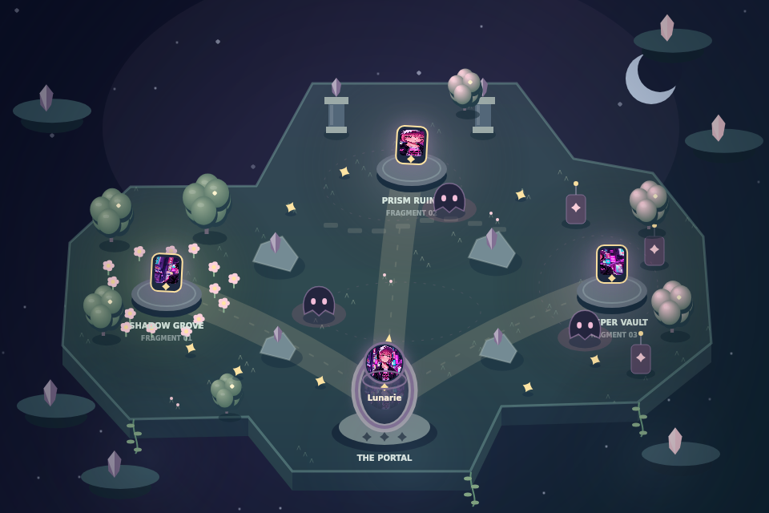

# Game module audit and overhaul — 13 October 2026

The previous Play tab ran a disconnected sample game. This change replaces it with **The Lost Fragments**, one authored adventure personalized by the selected artwork.

## Findings

Audit baseline: commit `3f1f7de`, plus a walkthrough of the live studio at `https://artoy.bryanlauwk.fun/`.

| Finding                                   | Evidence in the baseline                                                                                                    | Effect                                                                  |
| ----------------------------------------- | --------------------------------------------------------------------------------------------------------------------------- | ----------------------------------------------------------------------- |
| Artwork and gameplay were disconnected    | `TryItNow.tsx` always rendered `SampleGame`, which supplied a sample avatar. `PixelSocialSim` rejected a missing sample ID. | Uploaded characters could not inhabit their own universe.               |
| Generation had no playable asset contract | The API's “Mini Game” request produced a four-pose concept sprite sheet, which Play never consumed.                         | Generated game art was an image download, not a playable character.     |
| Character identity was replaced           | The renderer drew a chameleon body with a small circular face crop.                                                         | Every input became the same mascot instead of retaining its silhouette. |
| Waiting counted as winning                | `timeLeft <= 0` called `finishRound(true)`.                                                                                 | Players could finish without recovering the gems.                       |
| Timing depended on frame rate             | Movement, stamina, patrols and the clock advanced once per animation frame.                                                 | Different displays and slow devices changed game speed.                 |
| Entry demanded too much learning          | Color thresholds, paint stamina and stealth required a multi-step tutorial; other character stages were locked.             | The demo delayed the first meaningful interaction.                      |

The supplied visual references established the intended relationship: an identifiable character inhabits a coherent world and becomes a playable experience alongside collectible concepts. They were used as product references, rather than as a claim that their illustrated game scenes already existed in the app.

## Curated template

**Premise:** the character's portal has lost its light. Recover three pieces of its artwork to restore the universe, then bring the hero home.

- **One map, one rule set:** a moonlit floating island with Shadow Grove, Prism Ruins and Whisper Vault. Terrain geometry and the four solid rocks match the collision model. Decorative scenery is not additional collision geometry.
- **One main action:** move and dash. Dash protects the hero and stuns roaming inklings for 2.5 seconds, followed by a 1.25-second recharge. Patrol routes remain visible, and an objective compass points to the nearest uncollected fragment or the opened portal.
- **Clear stakes:** three hearts and 90 seconds. Completion requires all fragments plus entering the portal. Timeout and losing every heart are losses.
- **Replay and reveal:** optional sparks, remaining time and surviving hearts improve the score. Completing the chapter unveils the generated figurine concept from the same source artwork, with a route to the Merch tab. Without a successful concept image, the archive reveals a digital character card using the original art. Failed concept images fall back to that card; losing and restarting do not retain the reveal. Personal bests are local to each original artwork; they confer no physical merchandise reward or purchase entitlement.
- **Artwork integration:** original art is immediately playable as a framed floating token. Its palette themes the environment, three actual image slices become the fragments, and the whole artwork appears inside the portal. The neutral signature palette is clearly labeled when usable colors cannot be extracted.
- **Generated hero:** the API now creates one isolated full-body **Game Character**. It preserves the identity reference and requests a plain white background, minimal margins and no extra poses. Edge-connected near-white pixels are removed locally and transparent margins are trimmed. The full generated image is used as the playable hero, without adding a generic body. Missing or failed hero assets retain the original-art token.
- **Desktop and touch:** scoped keyboard controls, tap/drag destinations, held touch directions, dash, pause, restart, optional sound and optional fullscreen. Narrow canvases use a 640px camera view that follows the hero; the world remains 960×640. Inactive windows and hidden tabs pause the run. Reduced-motion preferences disable cosmetic animation.

The game engine is deterministic and independent of AI output. This provides a tested baseline for every input; generation changes the character asset, not the level rules. The original-art token is an intentional fallback, not automatic rigging or a guarantee that arbitrary artwork can become an animated character. The generated hero uses a single composited pose with subtle motion; it is not a skeletal animation system.

## Source organization

- `FragmentQuest.tsx`: controls, lifecycle, camera, audio, HUD and score persistence.
- `quest/engine.ts`: authored geometry, movement, dash, patrols, objective state and scoring.
- `quest/artwork.ts`: palette extraction and generated-image compositing.
- `quest/render.ts`: world art, character rendering and gameplay feedback.
- `TryItNow.tsx`: selected source and generated hero wiring, plus a sample entry before generation.
- `api/generate-universe.ts`: the single-hero prompt and per-asset error isolation, preserving other successful creations if one provider request fails.

Removed the old chameleon module, sample lock/progression helpers, unused game showcase, legacy art assets and obsolete audit script.

## Verification

- Nine persistent engine regression tests pass: completion conditions; timeout at 30/60/120 fps; phase/timer freezing; normalized frame-independent movement; dash and cooldown; damage grace period; rock/boundary collisions; map reachability; restart and scoring. Run `npm run test:game`.
- DOM integration checks used React StrictMode, a Happy DOM fixture and a native canvas adapter: start/pause/resume; scoped keyboard dash; window-blur pause; restart; artwork and palette reset; generated-hero success and failed-image fallback; white-edge removal and transparent trimming while preserving an enclosed white detail; timeout result; real `TryItNow` and `useCreatorSession` wiring for an uploaded source and a partial generated result; animation-frame cleanup on unmount.
- The world renderer was stubbed in the DOM lifecycle checks; the actual renderer was checked separately through the code render. The DOM fixture does not measure CSS layout or mobile overflow.
- An API-handler fixture simulating a failed Game Character provider request preserved the other seven successful assets and returned the partial results successfully.
- Generation responses and the full-body hero in those checks were local fixtures. Waitlist writes were disabled. No paid image generation was performed.
- Rendered and visually inspected the actual world renderer using the repository artwork. The image below is a code render, not a browser screenshot.
- TypeScript, changed-file ESLint, production build and whitespace checks pass. Production tooling still reports existing large-bundle and upstream dependency/deprecation warnings.

Full browser interaction and responsive layout verification were blocked by local-preview restrictions in this environment. Real phone testing, fullscreen/audio behavior on specific browsers and live AI asset quality remain to be verified before release. The DOM check is not a replacement for those checks.

## Next quality gate

Bryan selected a mysterious signature world and a collectible reveal on completion. **Lunarie** (`src/assets/artoy/lunarie.png`) is the chosen benchmark and default sample adventure. Her pink hair, cap, headphones, dark jacket and distinctive skull graphic provide concrete visible identity details to preserve across the source, game hero and figurine concept. Other samples remain freely selectable.

The current implementation is a functional foundation rather than the final owner-facing “wow” standard. That standard requires immediate recognition of the IP in motion, readable idle/run/dash animation, environmental details that meaningfully reflect the character, and a collectible reveal that carries the same identity. A single composited hero pose and palette changes alone do not satisfy it. The benchmark should be used to assess those improvements without changing the curated gameplay rules.

The follow-up DOM fixture verified that only a win reveals the concept, its image comes from the provided figurine asset, the concept action invokes navigation, image failure restores the source-art card, and restarting hides the reveal. The updated Lunarie world was rendered and visually inspected separately. TypeScript, changed-file ESLint, the nine engine tests and the production build pass. Browser/device and live-generation checks remain outstanding.

Play the chapter on a real phone and desktop, then test live generation with a doodle, an illustrated mascot, a dark/white-heavy character and multi-subject artwork. Check that the single hero stays recognizable and that edge cleanup does not erase white details connected to the outside. If live generation fails that visual contract, improve asset preparation while keeping the curated gameplay unchanged. Merch continues to be concept previews.
