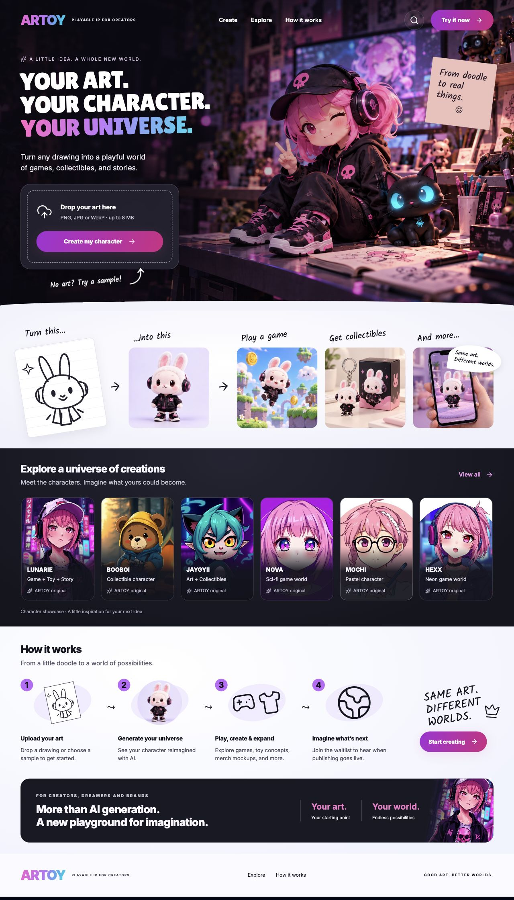

# ARTOY homepage redesign

The homepage follows the supplied “ARTOY: From Doodle to Universe” reference: a cinematic creative-studio hero, an upload card, a light doodle-to-world sequence, a dark character gallery, four illustrated steps and a compact footer.

## Behavior

- The hero accepts PNG, JPEG and WebP artwork up to 8 MB through the picker or drag and drop. Choosing a file stages it locally; the create action passes it to the existing generation flow.
- Create buttons open the existing studio in a keyboard-accessible dialog. The studio is loaded on demand. Existing generation, game progression and waitlist integration remain available.
- Gallery cards open details; View all switches between a horizontal gallery and a grid. The navigation collapses into a mobile menu.
- The page includes a skip link, named controls, focus restoration, visible focus states and reduced-motion support.
- Homepage copy does not present sample artwork as community submissions or show unverified user/like counts. Publishing is described as upcoming.

## Artwork

`hero-studio.png` and `bunny-universe.png` are newly generated assets based on the user-supplied design reference. They contain illustration only; navigation, typography, buttons and other controls are real HTML. The bunny atlas is shared by the four transformation examples to preserve character identity. The gallery retains existing ARTOY character assets.

## Previews

[Mobile homepage](previews/mobile.jpg)

## Validation

- Production build passes (existing dependency/bundle warnings remain).
- TypeScript check and ESLint on all changed TypeScript components pass.
- Browser checks covered desktop and mobile layouts, horizontal overflow, mobile navigation, valid image selection/removal, invalid file feedback, gallery details, gallery expansion, studio opening and Escape dismissal.
- Live paid AI generation and waitlist submission were not executed during UI verification.

## Follow-up

The raster assets should be converted to responsive delivery formats in the deployment image pipeline. The subsequent creator-journey update preserves studio state across dialog closure for the current page session. See `creator-journey.md`. Production publishing, pricing and external social destinations are outside this redesign.
