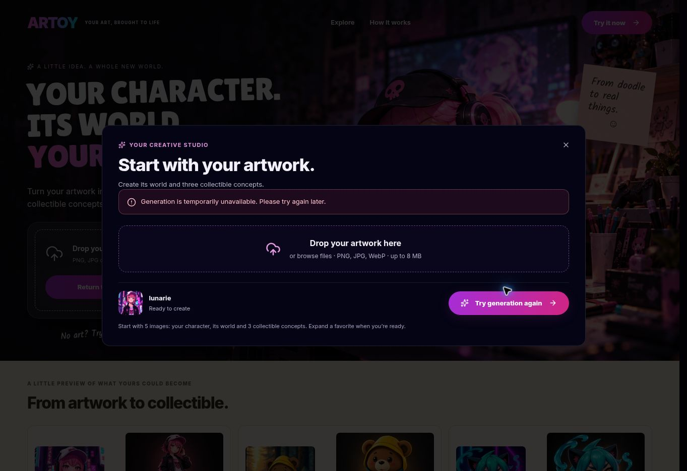

# Lunarie collection case study

One complete homepage study replaces the three simple artwork-to-figurine pairs. The page shows the original artwork, an illustrated world, three collectible forms, reference views, presentation packaging, related editions and a practical prototype step. It does not open another creator popup or trigger image generation merely by viewing the study.

## Evidence and limits

The full-body character and figurine are actual saved ARTOY production outputs from the successful 13 October 2026 run. The world, miniature, charm, views, packaging and series are six curated panels in one built-in image-generation sheet, conditioned on that original and verified figurine. These are not asserted to have passed the new ARTOY expansion workflow. A fresh upload was attempted through the public site's UI on 14 October MYT; it returned the generation-unavailable message. No retry was made. The client maps that message to its HTTP 402 branch, but no raw response capture was retained.

The original, character and figurine were reviewed for face, hair, cap, headphones and skull-clothing continuity. The six supplementary panels retain the same approved toy proportions. The series changes only accessories, base accents and companion details. Product views are visual interpretations, not CAD or an engineering specification. The evidence accordion on the website states these boundaries explicitly.

## Physical prototype feasibility

The repository includes a 1:1 A4 PDF paper proof for a proposed 50 x 60 mm rounded rectangular charm. It includes a 4 mm attachment-hole guide and 100 mm scale bar. A 2-3 mm clear acrylic unit is proposed for fabricator review; print registration, edge/hole clearance, hardware and durability remain untested. No physical unit was made or ordered. The page offers the PDF as a paper proof, never as a production cutting file.

## Verification

TypeScript, changed-file lint, production build and whitespace checks apply. The PDF was rendered with Poppler and inspected. Case-study asset dimensions, hashes and provenance are recorded in the adjacent JSON manifest. Source-generated static markup contains each of the six distinct SVG viewports and the proof download. The generated contact sheet was visually reviewed at full resolution.

A browser-rendered local component preview could not be opened: the cloud browser rejects file URLs, and local Chromium requires unavailable socket permissions. Those restrictions were respected. Live website visual QA of this new section remains pending after the owner publishes. The only production browser run this change performed was the generation attempt described above.

Merge only; owner publishes manually in Lovable.

The collection is now one of three examples in a toggle-driven common template. The separately saved full-body character remains archived evidence; the visible first panel shows the original artwork. Prototype and evidence notes are collapsed by default. See collection-showcase.md for current presentation and switching checks.
